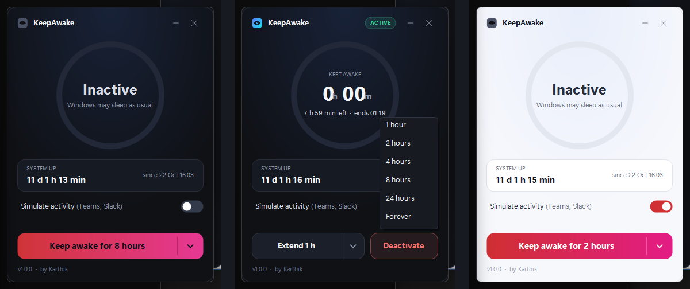

# KeepAwake

A tiny, portable Windows utility that keeps your PC awake - with a live countdown ring, tray controls, and optional activity simulation for apps like Teams and Slack.



## Features

- Keep awake for 1 h, 2 h, 4 h, 8 h (default), 24 h, or Forever
- Live countdown ring with gradient progress and elapsed time
- Extend the session anytime from the window or the tray menu
- Optional activity simulation - a subtle mouse nudge every 60 s so meeting apps and webpages never see you idle
- System uptime card with boot time and session status
- Light, Dark, and System themes (follows Windows accent colour)
- Single portable exe, no install, no admin rights, < 1 MB

## Download and run

Grab the latest **KeepAwake.exe** from [GitHub Releases](../../releases) and run it - no installation needed.

**Note:** Windows SmartScreen may warn about unsigned apps. Click **More info > Run anyway** to continue.

**Requirements:** Windows 10 (1903+) or Windows 11, 32- or 64-bit.

**Limits:** keeping the PC awake works through `SetThreadExecutionState`, which does not stop a sleep you start yourself (Start > Sleep, the power button, closing the lid when the lid action is Sleep). Some corporate policies and Modern Standby setups can still turn the display off.

## Usage

### Window
- Drag the header strip to move the window; minimize and close hide it to the tray (left-click the tray icon to bring it back). **Quit** is only in the tray menu
- The main split button starts a session for the selected duration - pick it from the chevron menu
- While active: **Extend 1 h** (chevron offers 1 h, 2 h, 4 h, Forever) and **Deactivate**
- Toggle **Simulate activity (Teams, Slack)** to enable idle-app nudges while awake
- When a timer expires, a toast tells you the session is finished

### Tray menu
- Double/single-click the tray icon to show the window
- Tooltip shows the remaining time, e.g. `KeepAwake - Active - 2 h 37 min left`
- **Extend >** (1 h, 2 h, 4 h, Forever), **Deactivate**, **Theme >** (System, Light, Dark), **Quit**
- Exiting KeepAwake properly deactivates the awake session first

### Theme
Choose **System** (default), **Light**, or **Dark** from the tray menu; changes apply instantly.

## Settings file

`keepawake.json` is stored beside the exe (fallback: `%LOCALAPPDATA%\KeepAwake\`):

```json
{ "lastDurationMinutes": 480, "simulateActivity": false, "theme": "System" }
```

Your last duration, simulation toggle, and theme are remembered. Delete the file to reset to defaults. A missing or invalid file means defaults; it is rewritten on the next change. If the file beside the exe is read-only, the settings move to the `%LOCALAPPDATA%\KeepAwake\` folder.

## Build from source

Requires the [.NET 8 SDK](https://dotnet.microsoft.com/download/dotnet/8.0). The .NET Framework 4.8 reference assemblies come from the build-only `Microsoft.NETFramework.ReferenceAssemblies` package, so no targeting pack needs to be installed. Nothing from that package ships in the exe.

```bash
dotnet build -c Release src/KeepAwake
```

The build produces a single **KeepAwake.exe** (targeting .NET Framework 4.8, which ships with Windows 10 1903+) in `src/KeepAwake/bin/Release/net48/`.

## How it works

- While active, KeepAwake calls `SetThreadExecutionState(ES_CONTINUOUS | ES_SYSTEM_REQUIRED | ES_DISPLAY_REQUIRED)` so Windows won't sleep or turn off the display; deactivating restores the default state
- With simulation enabled, it sends a 1-pixel `SendInput` mouse move back-and-forth every 60 s - invisible to you, but enough to reset idle timers in Teams, Slack, and web pages

## Privacy

No network access, no telemetry, no registry writes - the only file it creates is its own settings JSON.

## License

Released under the [MIT License](LICENSE).

## Author

Made by **Karthik**. Feedback and issues welcome on GitHub.
